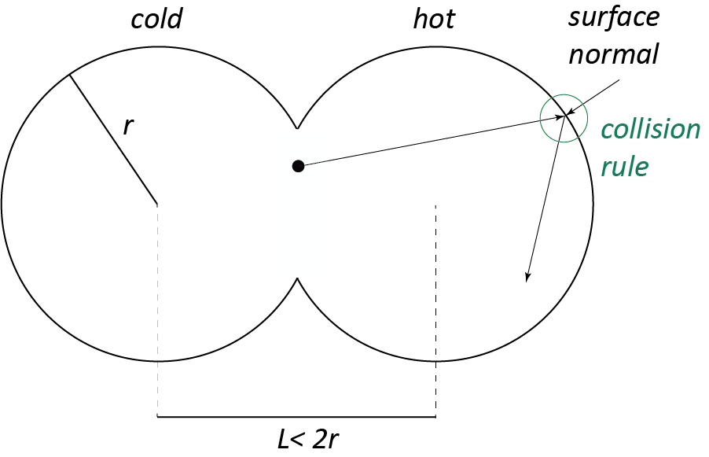

# CTL-flux-weighted-maxwellian

Consider two circular urns (in 2D) of equal radius  $r=1$ at center-center separation distance $L<2r$. The urns overlap, the cross-section (the 'hole') is a line of length $d$ which follows from $(L/2)^2+(d/2)^2=r^2$. Let a point particle (with unit mass $m=1$) move in straight lines within the interior of the two-urn system, starting from the center of the circular cross-section, with a random velocity $\vec{v}$. The particle can pass through the circular hole, and collide with urn walls. The two urns walls are held at fixed, but different temperatures $T_C>0$ (cold, left urn) and $T_H>T_C$ (hot, right urn). Maxwell considered two types of collision rules which we implement here. (i) A specular reflection with probability $1-\alpha$, and (ii) a thermal reflection with probability $\alpha$. Apart from the hole diameter $d$, this model has parameters $\alpha$, $T_C$ and $T_H$. We choose $d=0.1$ and $T_C=1$ throughout, so that the only remaining model parameters are $\alpha$ and $T_H$. 

#### Background: Classical Maxwellian velocity distribution 

The classical 'bulk' Maxwellian velocity probability distribution for a 2D system at temperature $T$ is (all particles are assumed to have mass $m=1$)

$$f_{\rm bulk}(\vec{v}) = \frac{1}{2\pi T} \exp\left[-\frac{v_x^2+v_y^2}{2k_BT}\right],$$

if we denote by $v_x$ and $v_y$ the cartesian components of the velocity vector $\vec{v}=(v_x,v_y)$. The denominator $2\pi T$ originates from the requirement, that $f(\vec{v})$ is normalized, 

$$\langle 1\rangle_{\rm bulk} = \int_{-\infty}^\infty dv_x \int_{-\infty}^\infty dv_y \ f_{\rm bulk}(\vec{v}) = \int_0^\infty ds \int_0^{2\pi} d\phi\ s f(s\ \cos\phi,s\ \sin\phi) = 1.$$

Here we just mentioned how the integral is usually evaluated upon introducing polar coordinates $v_x=s\ \cos\phi$ and $v_y=s\ \sin\phi$, with speed $s=|\vec{v}|\in\Re_{>0}$ and angle $\phi\in[0,2\pi]$, and the additional factor $s$ stems from the Jacobian. 
Similarly, the mean speed and the mean squared speed are 

$$\langle |\vec{v}|\rangle_{\rm bulk} = \langle s\rangle_{\rm bulk} = \int_0^\infty ds \int_0^{2\pi} d\phi\ s^2 f_{\rm bulk}(s\ \cos\phi,s\ \sin\phi) = \frac{\sqrt{\pi k_BT}}{\sqrt{2}}$$ 

$$\langle v^2\rangle_{\rm bulk} =\langle s^2\rangle_{\rm bulk} = \int_0^\infty ds \int_0^{2\pi} d\phi\ s^3 f_{\rm bulk}(s\ \cos\phi,s\ \sin\phi) = 2 k_BT.$$

The mean kinetic energy of a particle of unit mass in 2D is therefore $\frac{1}{2}\langle v^2\rangle_{\rm bulk} = 2k_BT$, which is one $1\ k_BT$ per space dimension. If one wants to create a velocity randomly drawn from the bulk Maxwellian distribution, one can use two normal distributed components $v_x$ and $v_y$, while making sure that the standard deviation of the normal distribution is chosen such that $\langle v^2\rangle_{\rm bulk} = 2 k_BT$ indeed holds. 

#### Specular reflection with probability $1-\alpha$
During a specular reflection, the particle is elastically scattered at the urn wall, and does not feel the urn wall temperatures. If the incoming velocity of the particle is denoted by vector $\vec{v}$, and the urn's surface normal at the location of the collision point denoted by vector $\vec{n}$ (a unit vector!), then the velocity $\vec{v}_\textrm{reflected}$ of particle after reflection is given by 

$$\vec{v}_\textrm{reflected} = \vec{v} - 2(\vec{v}\cdot\vec{n})\vec{n}$$

#### Thermal reflection with probability $\alpha$

During a thermal reflection the particle is affected by the wall temperature $T$ at the collision point. $T$ is either $T_C$ or $T_H$, depending on where the collision occurs. The velocity after collision is randomly sampled from the so-called flux-weighted Maxwellian (or surface Maxwellian) 

$$f_\textrm{surf}(\vec{v}_\textrm{reflected}) \propto v_n \ \exp\left[-\frac{v_n^2+v_t^2}{2k_BT}\right],$$

where $v_n\in\Re_{>0}$ is the normal component of $\vec{v}_\textrm{reflected}$, and $v_t\in\Re$ its tangential component with respect to the inward-pointing surface normal $\vec{n}$ at the collision point. That is, 

$$\vec{v}_\textrm{reflected} = v_n \vec{n} + v_t \vec{t},$$

where $\vec{t}$ apart from a sign is determined by $\vec{n}\cdot\vec{t}=0$ (the sign does not matter). 

## Task 1 

This tasks should result in a function to be used in subsequent tasks. For a given surface normal vector $\vec{n}$, create a random reflected velocity vector $\vec{v}$ 
that satisfies the flux-weighted maxwellian. To test your implementation, calculate the mean speed and mean squared speed of a large set of created $\vec{v}_\textrm{reflected}$ vectors. You should find 

$$\langle |\vec{v}_\textrm{reflected}|\rangle_\textrm{surf} = \frac{\sqrt{8 k_BT}}{\sqrt{\pi}}$$

$$\langle v_\textrm{reflected}^2\rangle_\textrm{surf} = 3 k_BT$$

The function ("thermal reflection") should take the surface normal and temperature as input arguments and return a velocity vector. Add another function ("specular reflection") that takes the surface normal as input argument and returns a velocity vector using the formula mentioned earlier. 

## Task 2

You may wonder why the mean squared velocity of a particle during thermal reflection is not identical with the mean squared bulk velocity. To resolve this puzzle, implement the dynamics of a single particle in the two-urn system at $\alpha=1$ (only thermal reflections), while both urns are held at the same temperature, $T_C=T_H=1$. As mentioned, let the particle start at the center of the system, with a random velocity (such as one drawn from the bulk Maxwellian), and then follow the particle during 10000 (or more) thermal collision events. Calculate the mean squared velocity of this particle with small error bar. What do you obtain and how can this be explained? 

Remark: The same result you'd obtain if you consider a single circular urn at temperature $T=1$, and let the particle start anywhere inside this urn. 

## Task 3

Now study the two-urn system with hole diameter $d=0.1$, where the cold urn wall is at temperature $T_C=1$, and the hot urn wall at temperature $T_H = 2$, while $\alpha$ takes values between 0 and 1. Let particles start at the center of the system with velocities drawn from the bulk Maxwellian with $T=(T_C+T_H)/2$. Then measure the stationary mean speeds $\langle s\rangle_C$, $\langle s\rangle_H$, and mean squared speeds $\langle s^2\rangle_C$, $\langle s^2\rangle_H$ in the two urns C and H separately and plot the result versus $\alpha$. Discuss the cases of $\alpha=0$ and $\alpha=1$ to understand these limits. Compare your result with a theoretical prediction 

$$\frac{\langle s\rangle_C}{\langle s\rangle_H} = \frac{\alpha^{-1}+(c_t+\alpha^{-1}) \sqrt{T_C/T_H}}{c_t + \alpha^{-1} + \langle c\rangle  \sqrt{T_C/T_H}}, \qquad c_t = \frac{2\pi}{d} - 1$$

## Task 4

Using data from task 4, evaluate 

$$\frac{\langle s^2\rangle_C}{\langle s\rangle_C}\quad{\rm and}\quad\frac{\langle s^2\rangle_H}{\langle s\rangle_H}$$

as function of $\alpha$, and verify if these ratios are different or identical to the ratios of moments we provided above.  
From kinetic theory it follows that these ratios are proportional to the pressures $p_C$ and $p_H$ in the cold and hot urns, respectively. You are hence in the position to evaluate the pressure ratio 

$$\frac{p_C(\alpha,T_C/T_H)}{p_H(\alpha,T_C/T_H)}$$ 

as function of $T_C/T_H$ and $\alpha$, by redoing task 3 at temperatures $T_H=1,2,5,10,20$ and many $\alpha$, and then evaluate the $\alpha$-dependent exponent $\gamma(\alpha)$ in the relationship 

$$\frac{p_C}{p_H} \approx  \left(\frac{T_C}{T_H}\right)^{\gamma(\alpha)}.$$

Plot $\gamma(\alpha)$ as function of $\alpha$ and discuss the limits $\alpha=0$ and $\alpha=1$. You should ideally obtain $\gamma(0)=0$ and $\gamma(1)=1/2$. 

## Questions you may try to answer: 

Can you find a simple explanation for the form of the flux-weighted Maxwellian? Why not use the bulk Maxwellian (or its half-space version) in the thermal collision rule? 
